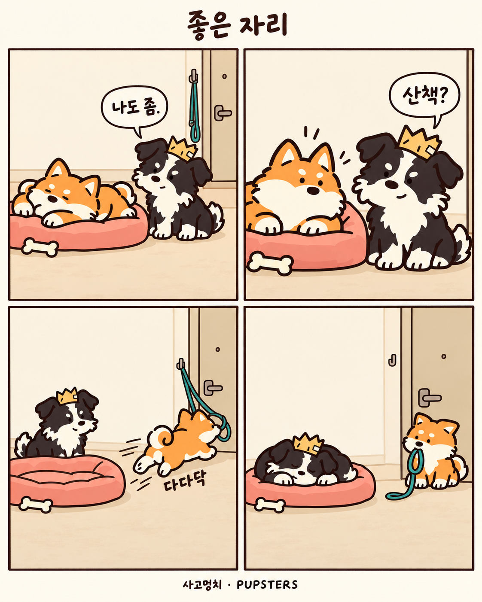

# 사고멍치 SNS 인수인계

2026년 10월 28일 전달본입니다. 최신 4컷 **〈좋은 자리〉**, 제작 규칙, 캐릭터 참고 원화와 브랜드·SNS·키즈 기획을 묶었습니다. 그림 제작일과 조사 기준일은 **2026년 10월 27일**입니다.

**다음 작업은 [HANDOFF.md](HANDOFF.md)부터 읽으세요.** 최신 만화는 제작과 내부 검토가 끝났지만 **사용자 검토 대기**입니다. GitHub에 올렸다는 이유로 작화 승인이나 SNS 게시 완료로 해석하지 않습니다.

## 바로 열기

- [최신 그림 원본](comic/EP01-good-spot.png) — 1122×1402 PNG
- [다음 작업 메모](HANDOFF.md)
- [전체 ZIP 다운로드](pupsters-handoff-20261028.zip)
- [브랜드와 세 채널 운영안](brand/index.html)
- [4컷 대본](comic/storyboard.txt) · [캡션과 대체 텍스트](comic/caption.txt)
- [스킬 분석과 반영 규칙](comic/workflow-notes.txt) · [실제 생성 프롬프트](comic/generation-prompt.txt)
- [그림 검수 기록](comic/review.txt) · [상태·이미지 해시](comic/manifest.json)

## 폴더 구성

| 폴더 | 내용 |
| --- | --- |
| `comic/` | 최신 4컷 〈좋은 자리〉, 대본·캡션·프롬프트·검수 |
| `brand/` | 브랜드, SNS 회차, 국내외 참고 자료, 플랫폼·상표 조사, 키즈 운영 계획 |
| `brand/assets/` | 강아지 여섯 마리의 참고 원화 |
| `reference/` | 2D 아트 방향과 선 두께 기준 |
| `kids/` | 〈왕관보다 큰 집〉 대본·콘티·필요 소재. 영상은 미제작 |
| `archive/rejected-ep01/` | 사용자가 거절한 첫 재채기 만화. 실패 기록용이며 사용 기준 아님 |

## 기존 게임 작업

[10월 26일 2D 게임 인수인계](https://github.com/zaelee/ZZEE/tree/gh-pages/20261026-pupsters-2d)에서 캐릭터·몹·배경·UI 전체를 이어서 작업할 수 있습니다. 이 폴더는 그 뒤 진행한 SNS와 브랜드 작업의 추가 인수인계입니다.

비용·정책·상표 조사 기록은 조사일 당시 자료입니다. 실제 출시·가입·납부 전에 현행 공식 조건을 다시 확인합니다. 계정·예약 자동화는 파일을 내려받는 것만으로 다른 PC에 이전되지 않습니다.
